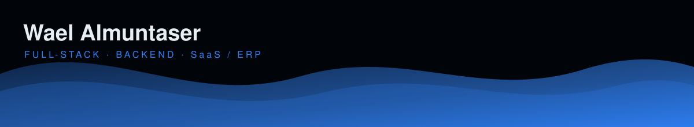

  

<h1 align="center">
  مرحباً، أنا <a href="https://waelalmuntaser.com">وائل عادل أحمد المنتصر</a> 👋
</h1>

  

  
  
  
  

  
  
  

## 🧑‍💻 نبذة عني

مهندس برمجيات **Full-Stack** متخصص في **هندسة الـ Backend** و**أنظمة SaaS / ERP القابلة للتوسع**.
خبرة في **.NET و Laravel و Node.js و PostgreSQL و SQL Server** و **REST APIs** — قوي في تصميم الأنظمة،
**Clean Architecture**، **CQRS**، **الأنظمة متعددة المستأجرين**، و**تحسين قواعد البيانات**.
أُسلّم أنظمة إنتاجية من البداية للنهاية: من المتطلبات والعمارة حتى النشر والصيانة.

- 🔭 أعمل حالياً على **منصات SaaS / ERP مؤسسية في شركة تبويب**
- 🧠 أتعمق في **هندسة الذكاء الاصطناعي — LLM و MCP و AI Agents**
- 🏗️ أهتم بـ **Clean Architecture و CQRS وتعدد المستأجرين وأداء الاستعلامات**
- 📍 مقيم في **صنعاء، اليمن**
- 💬 اسألني عن **.NET · Laravel · System Design · Database Optimization**
- 📫 راسلني: **waelalmunaster2022@gmail.com**

<table align="center">
  <tr>
    <td align="center"><h3>4+</h3>سنوات خبرة</td>
    <td align="center"><h3>10+</h3>مشروع منجز</td>
    <td align="center"><h3>1K+</h3>مستخدم للأنظمة</td>
    <td align="center"><h3>30%</h3>أسرع في الاستعلامات</td>
  </tr>
</table>

 

## 🛠️ المهارات التقنية

| المجال | التقنيات |
| :-- | :-- |
| **⚙️ الخلفية** |       |
| **🎨 الواجهة** |        |
| **🗄️ قواعد البيانات** |    |
| **🏛️ العمارة** |      |
| **🤖 هندسة الذكاء الاصطناعي** |      |
| **🔌 التكاملات** |       |
| **🚀 الأدوات و DevOps** |         |

## 📊 إحصائيات GitHub

  
  

  

  

<picture>
  <source media="(prefers-color-scheme: dark)" srcset="https://raw.githubusercontent.com/Wael-Almuntaser/Wael-Almuntaser/output/github-contribution-grid-snake-dark.svg" />
  <source media="(prefers-color-scheme: light)" srcset="https://raw.githubusercontent.com/Wael-Almuntaser/Wael-Almuntaser/output/github-contribution-grid-snake.svg" />
  
</picture>

## 🚀 مشاريع مختارة

### أكاديمية ترياض — `Sports Academy & Subscription Management`

منصة Full-Stack لإدارة الأكاديميات الرياضية تغطي التسجيل والاشتراكات والحضور والمدفوعات والعمليات اليومية.

- صلاحيات حسب الدور لـ **6+ أنواع مستخدمين** مع تحكم على مستوى الوحدات
- مدفوعات **Moyasar** + فواتير **PDF** تلقائية (Apple Pay والبطاقات)
- حضور لحظي عبر **QR** مع إشعارات WhatsApp / SMS تلقائية

   

🔗 **الموقع** → [tryadh.com/](https://tryadh.com/)

### بنا ديزاين — `Architecture & Contracting Marketplace`

سوق إلكتروني يربط العملاء بالمعماريين والمقاولين — خدمات ومحافظ أعمال ومستخدمين وسير عمل آمن.

- نظام صلاحيات مع **سير عمل آمن**
- قاعدة بيانات مهندَسة لـ **10K+ سجل** (خدمات، محافظ، مستخدمين)
- REST APIs بمعدل **1K+ طلب / يوم**

  

🔗 **الموقع** → [benadesign.com/](https://benadesign.com/)

<b>📦 أعمال أخرى منشورة</b>

| المشروع | الوصف | الرابط |
| :-- | :-- | :-- |
| **SAMA Association** | Hearing-disability association portal | [زيارة](https://sm3-rs.com/) |
| **SMS4U** | Virtual messages store with instant delivery | [زيارة](https://sms4u.pro/) |
| **Al-Naba Contracting** | Contracting company corporate site | [زيارة](https://n-naba.com/) |

## 💼 الخبرة العملية

### شركة تبويب · مطور Full-Stack
`يوليو 2025 — الحاضر`

- منصات **SaaS / ERP** مؤسسية تخدم **1K+ مستخدم نشط**
- تصميم وتنفيذ **عمارة متعددة المستأجرين**
- وحدات مالية للتسعير والضرائب عبر سيناريوهات متعددة
- تحسين التسجيل → **انخفاض التسرب ~20%**
- تطبيق **CQRS** لفصل الاهتماميات وقابلية التوسع
- تحسين الاستعلامات → **استجابة أسرع ~30%**

### عمل حر · مطور Full-Stack
`2022 — 2025`

- تسليم **10+ تطبيقات ويب** ومنصات للشركات الصغيرة والمتوسطة
- REST APIs بمعدل **2K+ طلب يومي**
- تصميم وتحسين قواعد بيانات علائقية متنامية
- دورة كاملة: متطلبات → عمارة → نشر → صيانة

## 🎓 التعليم والشهادات

- 🎓 **بكالوريوس الأمن السيبراني والشبكات** — جامعة الرازي `(2025)`
- 🛰️ **CCNA 1, 2, 3** — GTI `(2025)`
- 🧩 تعلّم مستمر: تصميم الأنظمة، الأنظمة الموزعة، وهندسة الذكاء الاصطناعي

> «آمن بالتصميم، نظيف افتراضياً، وسريع بالقياس.»

## 📫 لنتواصل

  
  
  
  
  

⭐ إذا أفادك عملي، لا تنسَ تقييم المستودعات! 

